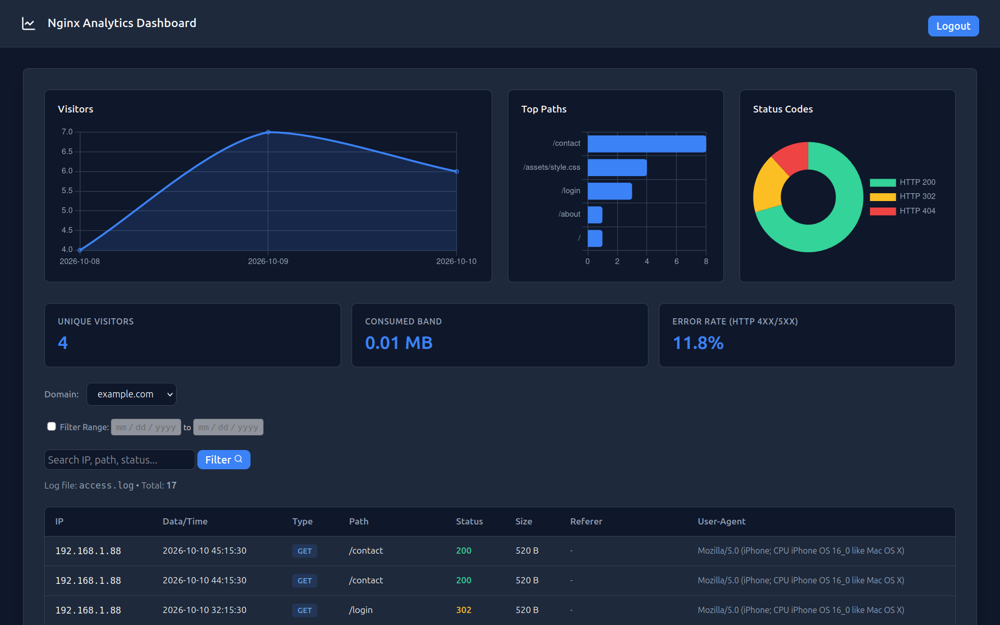

# Nginx Analytics Dashboard

A high-performance, multi-domain Nginx log analyzer built in Rust. It reads access logs incrementally and in real-time, stores them persistently in SQLite, and serves a clean, responsive web dashboard using Axum and Askama templates.



---

## Features

- **Real-Time Ingestion:** Uses a background Tokio worker to monitor and parse log files continuously.
- **Industrial-Grade Log Parsing (Inode + Byte-Offset):** Resilient against `logrotate`, file truncations, and application restarts. It tracks files using Unix inodes and byte offsets instead of line numbers.
- **Automated Data Retention:** Built-in periodic cleanup policy that automatically purges log entries older than 30 days to keep the database light and performant.
- **Multi-Domain Support:** Easily track multiple Nginx sites/logs from a single dashboard interface.
- **First-Run Setup Flow:** On initial launch, validates a provisional password (`PROVISIONAL_PASS`) from environment variables and forces the administrator to define secure, permanent credentials stored in SQLite hashed with **Argon2** (with UUIDv7 primary keys).
- **Secure Session-Based Auth:** Admin panel protected by server-side sessions (`tower-sessions`).
- **Rich Dashboard:** Interactive metrics, visits over time, top paths, status code breakdown, bandwidth calculators, error rate tracking, and paginated logs search.


---

## Tech Stack

- **Language:** Rust (Axum, Tokio)
- **Database:** SQLite via SQLx (Async)
- **Templating:** Askama
- **Security:** Argon2 (Password Hashing), UUIDv7 (Identifiers)
- **State Management:** `std::sync::Arc` (`AppState`) & `tower-sessions` (MemoryStore)
- **Static Assets:** `tower-http` (ServeDir)

---

## Dependencies:

- bun (https://bun.com)
- Rustup (https://rust-lang.org/)

---

## Configuration (`.env`)

Create a `.env` file in the root directory of your project. 

```env
PORT=3000
DOMAIN_NAME=analytics.example.com
DATABASE_URL=sqlite://nginx_analytics.db?mode=rwc
PROVISIONAL_PASS=change_this_password
CSS_PATH=/static/css/style.css
JS_PATH=/static/js/app.js
LOG_SOURCES=analytics.example.com=analytics.example.com.error.log
```

Example to add a domain:
```
LOG_SOURCES=example.com=example.com.access.log,api.example.com=api.example.com.access.log
```
<domain_name>=<nginx_log_file>, ...

> **Security Note:** `PROVISIONAL_PASS` is only used for the very first login. After completing the initial setup wizard, credentials are securely handled and verified against the database. Don't forget to change `PROVISIONAL_PASS` in .env

---

## Running Locally (Development)

1. Clone the repository and navigate to the project folder.
2. Set up your `.env` file.
3. Run build.ts with bun (create javascript bundle).

```bash
bun run build.ts
```

4. Build and run the project using Cargo:

```bash
cargo run --release
```

4. Open your browser at `http://127.0.0.1:3000` (or the port specified in your `.env`). On the first run, log in with username `admin` and your `PROVISIONAL_PASS` to register your permanent credentials.

## Production Deployment Guide

To run the application reliably in a production environment, you can set it up behind an **Nginx reverse proxy** managed by a **Systemd service**.

### Manual Production Deployment

Configure everything step-by-step:

#### 1. Systemd Service Configuration

Create the systemd service file:

```bash
sudo nano /etc/systemd/system/nginx-analytics.service

```

Paste the following configuration (adjust paths and user according to your server):

```ini
[Unit]
Description=Nginx Analytics Dashboard Service
After=network.target

[Service]
Type=simple
User=root
WorkingDirectory=/home/user/project
ExecStart=/home/user/project/target/release/binary_file
Restart=always
RestartSec=5
Environment=RUST_LOG=info

[Install]
WantedBy=multi-user.target

```

Enable and start the service:

```bash
sudo systemctl daemon-reload
sudo systemctl enable nginx-analytics
sudo systemctl start nginx-analytics

```

#### 2. Nginx Reverse Proxy Configuration

The application runs locally on the port defined in your `.env` (default: `3000`). Set up an Nginx server block to proxy traffic to it safely.

Create your site configuration:

```bash
sudo nano /etc/nginx/sites-available/analytics.example.com

```

Paste the configuration below:

```nginx
server {
    listen 80;
    server_name analytics.example.com;
    
    access_log /var/log/nginx/analytics.example.com.access.log;
    error_log /var/log/nginx/analytics.example.com.error.log;

    location / {
        proxy_pass http://127.0.0.1:3000;
        proxy_http_version 1.1;
        proxy_set_header Upgrade $http_upgrade;
        proxy_set_header Connection 'upgrade';
        proxy_set_header Host $host;
        proxy_cache_bypass $http_upgrade;
        proxy_set_header X-Real-IP $remote_addr;
        proxy_set_header X-Forwarded-For $proxy_add_x_forwarded_for;
        proxy_set_header X-Forwarded-Proto $scheme;
    }
}

```

Activate the configuration, test, and reload Nginx:

```bash
sudo ln -s /etc/nginx/sites-available/analytics.example.com /etc/nginx/sites-enabled/
sudo nginx -t
sudo systemctl reload nginx

```

#### 3. SSL Configuration with Certbot

Generate your free Let's Encrypt SSL certificate:

```bash
sudo certbot --nginx -d analytics.example.com

```
